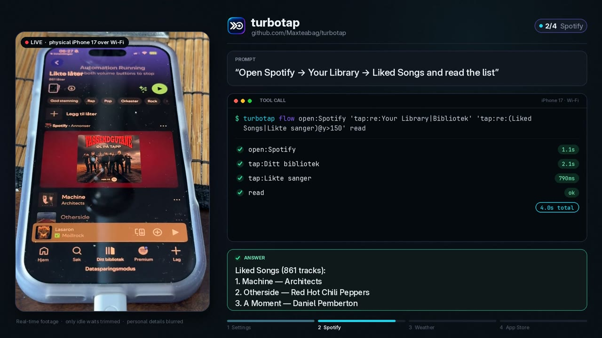

<p align="center">
  
</p>

<h1 align="center">turbotap</h1>

CLI for driving a real iPhone over Wi-Fi from your terminal or an AI agent (Claude Code, Codex, etc.).

<p align="center">
  <a href="https://github.com/Maxteabag/turbotap/releases/download/v0.2.0/turbotap-live-demo.mp4">
    
  </a>
  <br />
  <sub>Click to watch the 39 second demo on a real iPhone 17 over Wi-Fi.</sub>
</p>

I put this together because controlling an iPhone one screenshot at a time through an LLM is painfully slow. Grabbing a frame, waiting on the model to pick coordinates, and waiting another second per tap on stock WebDriverAgent turns a 5-tap task into a minute of waiting. `turbotap` takes a whole sequence of steps in one command, runs them locally against a patched WebDriverAgent on the phone, and returns JSON with the text and buttons on screen.

## Examples

```bash
# Open Settings -> General -> About and read the iOS version
turbotap flow launch:com.apple.Preferences scrollto:General tap:General tap:About wait:"iOS Version" read

# Open Spotify -> Your Library -> Liked Songs and read the list
turbotap flow open:Spotify tap:"Your Library" tap:"Liked Songs@y>150" wait:songs read:ocr tap:Back

# Open Weather and read the forecast (~0.6-1.1s)
turbotap flow open:Weather read

# Search the App Store for Angry Birds and install it
turbotap flow open:com.apple.AppStore search:"Angry Birds" tap:"Angry Birds 2" tap:Get
```

Run `turbotap flow --help` to see all available verbs (including `url:`, `toggle:`, `slider:`, `tapbatch:`, `scrollto:up:`, `longpress:`, `doubletap:`, `zoom:`, `swipe:`, `picker:`, `tapif:`, `waitany:`, `gone:`, `assert:`, `assertnot:`, `alert:text`, `key:`, `clipboard`/`setclip`, `re:` regexes, and `read:Y0-Y1` band OCR).

## Requirements

- An iPhone running iOS 17+ on your local Wi-Fi
- A Mac with Xcode (Apple requires it to sign and install WebDriverAgent on the phone. Once it's running, you can run `turbotap` from that Mac or from a Linux machine on the same network.)
- Python 3.10+ and Tesseract if you want local OCR

## Setup

Install the CLI and the agent skills:

```bash
uv tool install git+https://github.com/Maxteabag/turbotap.git
turbotap install-skill
```

That's it: the package carries the skills, the WebDriverAgent patch and the deploy script, so you don't need a clone. `install-skill` puts the skills in `~/.agents/skills` and `~/.claude/skills` (whichever exist; add `--codex` or `--dir DIR` for other agents), prints where they went, and refreshes them by itself after you upgrade with `uv tool install --force git+https://github.com/Maxteabag/turbotap.git`. `npx skills add Maxteabag/turbotap` installs just the skills too. `pip install git+https://github.com/Maxteabag/turbotap.git` works in place of uv, and `uv tool install --editable .` in a clone is for hacking on it.

Install Tesseract (used for local screen reading):

```bash
# macOS
brew install tesseract

# Ubuntu / Debian
sudo apt install libtesseract5 tesseract-ocr-eng

# Arch Linux
sudo pacman -S tesseract tesseract-data-eng
```

On the iPhone, turn on Developer Mode (`Settings -> Privacy & Security -> Developer Mode`) and UI Automation (`Settings -> Developer -> Enable UI Automation`). Note the phone's Wi-Fi IP under `Settings -> Wi-Fi -> (i)` and its UDID from your Mac with `xcrun devicectl list devices`.

Create `~/.config/turbotap/config.json`:

```json
{
  "default_device": "iphone",
  "mac_host": "mac",
  "team_id": "YOUR_APPLE_TEAM_ID",
  "bundle_id": "com.yourname.wda",
  "passcode_cmd": "your-secret-manager get iphone-passcode",
  "devices": {
    "iphone": {
      "url": "http://192.168.1.50:8100",
      "udid": "000081XX-XXXXXXXXXXXXXXXX"
    }
  }
}
```

Deploy and start the patched WebDriverAgent on the iPhone (over SSH to the Mac in `mac_host`), then make sure it responds:

```bash
turbotap deploy              # clone, patch, build and start WDA; --no-build just restarts it
turbotap preflight
turbotap unlock
```

Full walkthrough and troubleshooting (finding your Team ID, trusting the dev cert on first launch, multiple phones, SSH keychain tips) are in [docs/SETUP.md](docs/SETUP.md).

## Benchmarks

Stock WebDriverAgent waits for iOS animations to settle on every tap, sends full-res screenshots over HTTP, and runs expensive per-node AX queries on hidden UI nodes. [`wda-turbo.patch`](patches/wda-turbo.patch) skips most of that overhead, while `turbotap` keeps one HTTP connection open, caches session settings and screen dimensions per device, trims `/source` attributes, and runs strip-parallel LSTM OCR locally with dark-mode pre-inversion and strip hash caching.

| Operation | Stock WDA | turbotap | Notes |
|---|---:|---:|---|
| CLI startup (`--help` / UI-only) | ~150-210ms | **~55ms** | Lazy-loads Pillow/OCR; UI-only flows skip Tesseract init |
| Session startup | ~88ms (uncached) | ~14ms | Caches fast settings & screen size per device |
| Tap | 740-1200ms | ~260ms | Instant-wake `CFRunLoopStop` touch synthesis (`0.02s`) |
| Type text (27 chars) | ~725ms | **~350ms** (opt-in `240/s`) | `/wda/fastKeys` keeps legacy pace by default; set `TURBOTAP_TYPING_FREQ=240` for turbo |
| Double-tap / pinch-zoom | ~900ms+ | **~280ms / ~430ms** | `/wda/fastDoubleTap` and `/wda/fastPinch` (single-record `CFRunLoopStop`) |
| Cold app launch (`launch:APP`) | ~2,200ms | **~110-390ms** | `/wda/fastLaunch` (async XPC terminate + `LSApplicationWorkspace`, ~16x faster) |
| Unlock passcode (`unlock`) | ~11,660ms | **~4,730ms** | `/wda/fastUI` keypad poll + `/wda/fastTapBatch` (-59.4%) |
| Multi-tap keypad (`tapbatch:fixed:`) | ~2,600ms | **~613ms** | `/wda/fastTapBatch` (auto-chunked `<=4` paths/record for iOS multi-touch cap) |
| Grab frame | 123-244ms | ~34ms | On-device ImageIO thumbnail + raw binary JPEG |
| Read screen (OCR) | ~1470ms | 100-180ms | Parallel LSTM OCR + dark-strip pre-invert + caching (~50ms cached) |
| Scroll | ~2000ms | 150-350ms | Clean drag stop with no fling momentum (`dur=0.08, rel=0.08`) |
| UI tree | ~2600ms | 158-198ms | Single-RTT `/wda/fastUI?waitBundle=...` (trimmed `/source` fallback ~297ms) |
| Multi-step flow | 14.4-15.7s | **1.0-6.0s** | Single process, persistent connection, pixel-still confirmation, keypad cache |

[docs/HOW_IT_WORKS.md](docs/HOW_IT_WORKS.md) explains each trick behind these numbers: session caching, strip-parallel OCR, zero-momentum drag, trimmed UI trees, app-switch freshness, and iOS quirks.

If you don't want to patch WDA, `turbotap` still works against stock WDA and falls back to the standard endpoints automatically.

## Safety and quirks

By default, `turbotap` blocks taps on buttons matching `Send`, `Pay`, `Buy`, `Delete`, `Cancel booking`, or `Start call` (`--deny`). Pass `--no-deny` when you actually want it to press one of those.

`tap:TEXT` prefers a button, app keypad `Key`, or link labelled exactly `TEXT` over a longer OCR line (`tap:"Sign In"` won't hit `Sign in with another account`), and deprioritizes iOS status-bar matches (`y < 54`) behind in-app text unless targeted explicitly. `wait:TEXT` is OCR-first and falls back to the accessibility tree for low-contrast or colored buttons, while `gone:TEXT` polls until a spinner or sheet disappears. Tapping a switch row's label flips the switch itself, and `Next`/`Previous` pick the form's button over the keyboard toolbar's copy. When a step fails, the JSON lists the visible text and the top 30 interactive controls with their exact labels.

You can narrow down targets relative to other text on screen (`tap:"Alice@below:Chats"`, `tap:"Alice@y>300"`) or match dynamic text with `re:REGEX` in `wait:`, `waitany:`, `assert:`, `assertnot:`, `tap:`, and `scrollto:`. OCR matching folds Unicode/Nordic diacritics (`å`↔`a`, `ø`↔`o`, `æ`↔`ae`, `é`↔`e`, etc.) as a lower-priority fallback when exact diacritics are missed by Tesseract, and `scrollto:` falls back to accessibility controls on blank-OCR or end-of-list frames. `alert:text` reads an active system alert, and `read`/`ui` surface active SpringBoard alerts immediately after `open:`/`launch:` instead of stalling on stale-app retries.

Formatted iOS text fields (phone numbers, OTPs, IDs) tend to drop characters when pasted all at once. `type:` waits for brief keyboard focus after tapping an input, `key:return|backspace|tab|space|escape` sends control keys cleanly, `cleartype:TEXT` clears (`TextField`, `SecureTextField`, `SearchField`, `TextView`) and checks what landed, `dismisskb` closes the keyboard across localized labels in one lookup, and `typedigits:env:CODE` types one digit at a time. For banking or MDM PIN pads that iOS blacks out in screenshots, `pintap:env:APP_PIN` taps the keypad directly.

## Using with AI agents

`turbotap install-skill` (or `npx skills add Maxteabag/turbotap`) installs [skills/turbotap/SKILL.md](skills/turbotap/SKILL.md) for Claude Code, Codex, OpenClaw and other agents that read skill folders. It teaches the agent to batch steps into `turbotap flow` calls and to handle the input quirks above.

[skills/turbotap-retro/SKILL.md](skills/turbotap-retro/SKILL.md) is an optional companion: after each non-trivial task the agent reviews what slowed it down and fixes it once in `turbotap` itself, using generic primitives only.

## FAQ

### Where does the iPhone passcode live, and does Claude ever see it?

It stays on your machine and never enters the model's context. When `turbotap unlock` (or the `unlock` step in a flow) runs, the Python process runs your `passcode_cmd` itself, taps the digits on the phone over your local Wi-Fi, and prints `{"ok": true, "unlocked_now": true, "locked": false}`. The agent only ever sees that result, not the digits, and error messages never include them either.

`passcode_cmd` is whatever command prints your passcode, so you can use the secret store you already have. On macOS the Keychain works well and nothing gets written to disk:

```bash
# store it once (prompts for the passcode)
security add-generic-password -a "$USER" -s turbotap-passcode -w
```

```json
"passcode_cmd": "security find-generic-password -w -s turbotap-passcode"
```

Other options:

- Bitwarden: `"bw get password iphone-passcode"` or `"rbw get iphone-passcode"`
- 1Password: `"op read op://Private/iPhone/passcode"`
- pass: `"pass show iphone/passcode"`
- `WDA_PASSCODE_CMD` in the environment overrides the config value, and `WDA_PASSCODE` holds the passcode itself (simple, but it then sits in your environment)

The command runs without a shell, so wrap it in `sh -c '...'` if you need a pipe.

App PINs work the same way. `pintap:cmd:"security find-generic-password -w -s bank-pin"` or `pintap:env:APP_PIN` fetches the PIN locally and the step reports only `tapped 4 digits`. `type:`, `cleartype:` and `typedigits:` take `env:` (and `type:`/`cleartype:` also `cmd:`) for the same reason. Avoid writing the digits straight into a step like `pintap:1234`, since the agent then has them.

### How does it read the screen, accessibility tree or screenshots?

Both. `read` grabs a cropped, downscaled screenshot from the phone and OCRs it locally with `libtesseract` (`OEM_LSTM_ONLY`), split into strips that run in parallel in one process with dark-mode pre-inversion and strip caching (100-180ms cold, ~50ms cached). OCR sees everything that's drawn, including web views and apps with poor accessibility labels. It also pulls the accessibility tree via `/wda/fastUI` (158-198ms with `wda-turbo.patch`, or trimmed `/source` fallback in ~297ms) to catch what OCR misses: icon-only buttons, app keypad keys, unlabeled controls, switch states and exact field values. The agent gets the merged result as JSON text and tap targets, not images.

`read:ocr` skips the tree when you only need text, `read:Y0-Y1` OCRs a single vertical band 3-4x faster, and `ui` or `readel:TEXT` give you just the tree.

### Can it unlock the phone? Does it have to stay awake?

Yes, `turbotap unlock` or the `unlock` step in a flow. It does nothing if the phone is already unlocked. It finds the keypad keys by their `XCUIElementTypeKey` names instead of screen coordinates, so it works on any iPhone screen size.

The phone can auto-lock and sleep between tasks. WebDriverAgent keeps running, and when iOS has put Wi-Fi to sleep `turbotap` sends one ping to wake it before giving up, so start a task with `unlock` and carry on.

### Do I need a Mac, or does it talk to the iPhone directly?

Both, sort of. `turbotap` talks straight to WebDriverAgent on the iPhone over HTTP on your Wi-Fi, and none of your commands go through the Mac. But Apple only lets Xcode sign and launch WebDriverAgent, so you need a Mac once to install it, and the runner lives in an `xcodebuild` session on that Mac. Leave the Mac on and on the same network, and keep it reachable over SSH so `turbotap deploy --no-build` can restart the runner after the phone reboots. The machine running `turbotap` can be that Mac or any Linux box on the same network.

### Why a real iPhone and not the Simulator?

The Simulator can't install App Store apps or use your real accounts, and it skips the things that break real tasks: permission prompts, push notifications, the real lock screen, and real-device speed. Driving the actual phone covers all of it.

## License

MIT. See [LICENSE](LICENSE).
